<p align="center">
  
</p>

<p align="center">
  <a href="https://github.com/ishandutta2007/Awesome-Awesome-Awesome"></a><a href="https://discord.gg/jc4xtF58Ve"></a> <a href="https://github.com/ishandutta2007/Awesome-Retrieval-Augmented-Generation-Diagnostics/stargazers"></a> <a href="https://github.com/ishandutta2007/Awesome-Retrieval-Augmented-Generation-Diagnostics/network/members"></a> <a href="https://github.com/ishandutta2007/Awesome-Retrieval-Augmented-Generation-Diagnostics/pulls"></a> <a href="https://opensource.org/licenses/MIT"></a> <a href="https://github.com/ishandutta2007"></a>
</p>

---

# 🚀 Awesome Retrieval-Augmented Generation Diagnostics

> 🔬 **A curated ecosystem of SaaS platforms, open-source frameworks, and developer tooling for Retrieval-Augmented Generation (RAG) diagnostics, hallucination detection, context retrieval benchmarking, and continuous LLM evaluation pipelines.**

Retrieval-Augmented Generation (RAG) applications frequently suffer from silent regressions: hallucinated outputs, ungrounded answers, retrieval drift, irrelevant context injection, chunking failures, and latency bottlenecks. **RAG Diagnostics** platforms provide end-to-end evaluation metrics (**Faithfulness, Context Precision, Context Recall, Answer Relevancy, Groundedness**), full-stack OpenTelemetry tracing, automated test datasets, red-teaming, and LLM-as-a-judge scorers to transition GenAI applications from prototype to enterprise-grade production reliability.

---

## 📑 Table of Contents

- [📊 Sector Overview & Market Dynamics](#-sector-overview--market-dynamics)
- [🏢 SaaS & Hosted Platforms](#-saas--hosted-platforms)
- [💻 Open-Source GitHub Projects](#-open-source-github-projects)
- [📐 RAG Diagnostic Metrics Taxonomy](#-rag-diagnostic-metrics-taxonomy)
- [🛠️ Recommended Architecture Stacks](#️-recommended-architecture-stacks)
- [🤝 How to Contribute](#-how-to-contribute)
- [⚖️ Disclaimer](#️-disclaimer)
- [📈 Star History](#-star-history)
- [💖 Support & Sponsoring](#-support--sponsoring)

---

## 📊 Sector Overview & Market Dynamics

The **AI Model Evaluation and LLM Observability market** was valued at approximately **$2.5B – $3.3B in 2026** and is projected to expand to **$9.26B by 2030**, compounding at an aggressive **CAGR of ~36.2%**. This exponential surge is propelled by the enterprise migration toward agentic architectures, complex multi-hop RAG retrieval chains, and stringent compliance mandates (such as the EU AI Act) requiring auditable hallucination and safety guarantees.

The competitive landscape is currently **moderately fragmented**: standard-setting open-source frameworks (*Langfuse*, *Ragas*, *DeepEval*, *Phoenix*) command massive grassroots developer adoption, while high-growth evaluation specialists (*Braintrust*, *Galileo*, *Confident AI*) capture dedicated enterprise experimentation budgets. Rather than coalescing into a single winner-take-all monopoly, the sector exhibits active consolidation by incumbent observability titans—exemplified by Dynatrace's landmark **$915M acquisition of Arize AI** and ClickHouse's acquisition of Langfuse—creating a symbiotic environment between modular open-source libraries and enterprise cloud control planes.

---

## 🏢 SaaS & Hosted Platforms

The table below benchmarks premier commercial platforms for LLM evaluation, RAG tracing, and hallucination scoring. The list is **sorted in descending order by company valuation / scale**.

| 🏷️ Platform | 💰 Valuation / Company Size | 💳 Starting Pricing | 🎁 Free Tier Limits | 🔍 Core Diagnostic & RAG Capabilities |
| :--- | :--- | :--- | :--- | :--- |
| **[LangSmith](https://smith.langchain.com/)** | **$1.25 Billion** *(Series B led by IVP; $260M+ raised)* | **$39 / seat / month** *(Plus Tier; $2.50 per 1k overage traces)* | **Developer Plan (Free forever)**: 1 seat, 5,000 base traces/month, 14-day retention, playground access | Full trace tree inspection, prompt playground, dataset curation, automated LLM-as-a-judge scoring, annotation queues, online latency/cost telemetry. |
| **[Arize AX / Phoenix Cloud](https://arize.com/)** | **$915 Million** *(Acquired by Dynatrace in Aug 2026; $131M prior funding)* | **$50 / month** *(Arize AX Pro self-serve starting tier)* | **Arize AX Free Plan (Free forever)**: Up to 25,000 spans/month, 15-day data retention, 1 project | Real-time hallucination scoring, vector embedding drift visualization, context relevance analysis, root-cause blame attribution, OpenTelemetry native. |
| **[Braintrust](https://www.braintrust.dev/)** | **$800 Million** *(Series B in Feb 2026 led by ICONIQ; $121M raised)* | **$249 / month** *(Pro Plan with 50k scores &amp; 5 GB data/mo)* | **Starter Plan (Free forever)**: 1 GB data/month, 10,000 scores/month, 14-day retention, $10/mo model credits | API-driven custom scorers, offline dataset evaluation, CI/CD regression gating, prompt playground &amp; versioning, end-to-end trace logging. |
| **[Galileo AI](https://www.galileo.ai/)** | **~$250M – $300 Million** *(Series B led by Scale Venture Partners; $68.1M raised)* | **$100 / month** *($100/mo billed annually or $150/mo monthly on Pro)* | **Free Plan (Free forever)**: 5,000 traces/month, unlimited seats/users, unlimited custom evaluations | RAG Chunk Attribution, Groundedness, Context Adherence metrics, real-time guardrails, manual span decorators (`@log`), workflow span tracking. |
| **[Tonic Validate](https://www.tonic.ai/)** | **~$150M – $200 Million** *(Series B led by Insight Partners; $49M raised)* | **$500 / month** *(Commercial platform starting tier; $18,000/yr enterprise)* | **Open SDK (Free forever)** with 0 caps + **Cloud Sandbox with $5/month ongoing usage credits** | `ValidateScorer`, Answer Consistency, Augmentation Accuracy, Multi-LLM provider benchmarks (OpenAI, Claude, Mistral, AWS Bedrock). |
| **[Confident AI](https://www.confident-ai.com/)** | **~$15M – $20 Million** *(Seed led by Y Combinator; $2.2M raised; ~$550K ARR)* | **$1 / GB-month** *(Trace spans; Team tier from $20/seat/month)* | **Free Plan (Free forever)**: 5 GB-months trace ingestion, unlimited local DeepEval runs, regression dashboards | Native DeepEval cloud dashboard, G-Eval framework, conversational multi-turn testing, agent trajectory evaluations, synthetic test generation. |

---

## 💻 Open-Source GitHub Projects

Explore the leading open-source frameworks for self-hosted RAG diagnostics, continuous evaluation, and red teaming. Repositories are **sorted in descending order by GitHub Stars_Count**.

### 1. **[Langfuse](https://github.com/langfuse/langfuse)** [](https://github.com/langfuse/langfuse/stargazers)
* **Description**: **Full-platform open-source LLM engineering and observability platform.** Built on OpenTelemetry standards, Langfuse provides deep instrumentation for RAG pipelines and multi-agent workflows. It supports offline dataset experiments, prompt versioning, automated LLM-as-a-judge scoring, and CI/CD automated regression tests via GitHub Actions.
* **Key Features**: Tracing across OpenAI, LangChain, LlamaIndex, LiteLLM; evaluation datasets; latency, token, and cost tracking; fully self-hostable with Docker &amp; Kubernetes.
* **License**: MIT 📄

### 2. **[Promptfoo](https://github.com/promptfoo/promptfoo)** [](https://github.com/promptfoo/promptfoo/stargazers)
* **Description**: **Test-driven LLM evaluation, security red-teaming, and RAG benchmarking CLI.** Evaluates prompts, RAG retrievers, and agent responses against user-defined assertions (semantic similarity, BLEU/ROUGE, model-graded metrics, and hallucination probes).
* **Key Features**: Lightweight CLI (`promptfoo eval`), red-teaming against prompt injections and jailbreaks, declarative YAML test suites, deterministic caching, and GitHub Actions CI integrations.
* **License**: MIT 📄

### 3. **[DeepEval](https://github.com/confident-ai/deepeval)** [](https://github.com/confident-ai/deepeval/stargazers)
* **Description**: **"The pytest for LLMs" — Production evaluation and diagnostic framework.** DeepEval treats LLM and RAG testing like unit tests. It introduces G-Eval (research-backed criteria-based evaluation), synthetic goldens generation, conversational test cases, and agent trajectory diagnostics.
* **Key Features**: 14+ research metrics (Faithfulness, Answer Relevancy, Contextual Precision, Contextual Recall, Hallucination, Bias, Toxicity); `@observe` decorator; CLI (`deepeval test run`).
* **License**: Apache-2.0 📄

### 4. **[Ragas](https://github.com/explodinggradients/ragas)** [](https://github.com/explodinggradients/ragas/stargazers)
* **Description**: **The foundational reference framework for RAG evaluation.** Pioneered the standard formulation of RAG evaluation metrics without requiring extensive human-annotated ground-truth datasets.
* **Key Features**: Research-backed metrics (Faithfulness, Answer Relevance, Context Precision, Context Recall, Context Entities Recall, Noise Sensitivity, Factual Correctness); automated synthetic test dataset generation; CLI templates (`ragas quickstart`, `ragas evals`).
* **License**: Apache-2.0 📄

### 5. **[Arize Phoenix](https://github.com/Arize-ai/phoenix)** [](https://github.com/Arize-ai/phoenix/stargazers)
* **Description**: **AI observability, real-time tracing, and evaluation workbench.** Native OpenTelemetry engine for tracing LLM chains, agent execution loops, and vector database queries. Enables local execution or enterprise self-hosting with PostgreSQL persistence.
* **Key Features**: Local CLI (`uvx arize-phoenix serve`), 3D UMAP vector embedding cluster visualization to diagnose retrieval blind spots, LLM-as-a-judge benchmark evaluators, and automatic span instrumentation.
* **License**: MIT 📄

### 6. **[Giskard](https://github.com/Giskard-AI/giskard)** [](https://github.com/Giskard-AI/giskard/stargazers)
* **Description**: **Adversarial RAG diagnostics, automated red teaming, and quality audits.** Provides comprehensive scan suites to detect hallucinations, sycophancy, sensitive information leakage, and retrieval omissions.
* **Key Features**: `vulnerability_scan` for security probes; `quality_scan` for hallucination detection; component blame attribution (`component:retrieval` vs. `component:llm`); automated adversarial scenario generators.
* **License**: Apache-2.0 📄

### 7. **[TruLens](https://github.com/truera/trulens)** [](https://github.com/truera/trulens/stargazers)
* **Description**: **Evaluation and observability framework centered on the "RAG Triad".** Systematic verification that every generated token is grounded in retrieved context and directly addresses the user request.
* **Key Features**: RAG Triad feedback functions (Context Relevance, Groundedness, Answer Relevance); agent trace evaluation (Plan Adherence, Execution Efficiency, Tool Selection); MLflow and LangChain integrations.
* **License**: Apache-2.0 📄

### 8. **[UpTrain](https://github.com/uptrain-ai/uptrain)** [](https://github.com/uptrain-ai/uptrain/stargazers)
* **Description**: **Open-source LLM evaluation toolkit with 20+ pre-configured diagnostic checks.** Diagnoses failures across generation quality, retrieval quality, language tone, and conversational guidelines.
* **Key Features**: Context relevance, response completeness, factual accuracy, hallucination detection, prompt injection checks, and root-cause failure analysis dashboards.
* **License**: Apache-2.0 📄

### 9. **[OpenInference](https://github.com/Arize-ai/openinference)** [](https://github.com/Arize-ai/openinference/stargazers)
* **Description**: **OpenTelemetry semantic conventions and instrumentation packages for LLM, RAG, and agent applications.** Standardizes how retrieval queries, vector search documents, prompt tokens, and tool calls are captured into telemetry spans across Python and TypeScript.
* **Key Features**: Auto-instrumentation for LangChain, LlamaIndex, DSPy, Haystack, LiteLLM, OpenAI, and Anthropic.
* **License**: Apache-2.0 📄

### 10. **[Continuous-Eval](https://github.com/relari-ai/continuous-eval)** [](https://github.com/relari-ai/continuous-eval/stargazers)
* **Description**: **Modular open-source evaluation framework for RAG and LLM systems.** Combines deterministic matching, semantic similarity, and LLM-as-a-judge approaches with granular pipeline breakdown.
* **Key Features**: Modular evaluation graphs, synthetic dataset generation, component-level blame attribution, and multi-turn conversational evaluation.
* **License**: Apache-2.0 📄

### 11. **[Tonic Validate](https://github.com/TonicAI/tonic_validate)** [](https://github.com/TonicAI/tonic_validate/stargazers)
* **Description**: **Lightweight developer SDK for scoring RAG answer consistency and retrieval accuracy.** Integrates easily into unit testing suites, local Jupyter notebooks, and CI pipelines.
* **Key Features**: `ValidateScorer`, Answer Consistency metric, Augmentation Accuracy metric, multi-model evaluation runners (OpenAI, Anthropic Claude, AWS Bedrock).
* **License**: MIT 📄

### 12. **[OpenAgent Eval](https://github.com/OpenAgentHQ/openagent-eval)** [](https://github.com/OpenAgentHQ/openagent-eval/stargazers)
* **Description**: **Local-first, privacy-focused RAG and agent evaluation CLI.** Requires zero external cloud accounts or third-party telemetric tracking.
* **Key Features**: 18+ metrics across retrieval (MRR, NDCG, Precision@K) and generation (Faithfulness, NLI similarity); Corpus Health Auditor; component fault localization (`oaeval audit`, `oaeval diagnose`).
* **License**: Apache-2.0 📄

---

## 📐 RAG Diagnostic Metrics Taxonomy

When diagnosing a failing Retrieval-Augmented Generation pipeline, decouple **Retrieval Quality** from **Generation Quality** to pinpoint failure root causes:

```
                  ┌─────────────────────────────────────────────────────────┐
                  │                      USER QUERY                         │
                  └───────────────────────────┬─────────────────────────────┘
                                              │
                      ┌───────────────────────┴───────────────────────┐
                      ▼                                               ▼
     ┌─────────────────────────────────┐             ┌─────────────────────────────────┐
     │      RETRIEVAL DIAGNOSTICS      │             │     GENERATION DIAGNOSTICS      │
     ├─────────────────────────────────┤             ├─────────────────────────────────┤
     │ • Context Precision             │             │ • Faithfulness / Groundedness   │
     │ • Context Recall                │             │ • Answer Relevance              │
     │ • Context Relevance             │             │ • Hallucination Index           │
     │ • Noise Sensitivity (Irrelevant)│             │ • Information Omission Rate     │
     │ • Chunk Duplication / Staleness │             │ • Refusal Accuracy              │
     └─────────────────────────────────┘             └─────────────────────────────────┘
```

| 🧪 Metric | 🎯 Evaluation Target | 💡 Diagnostic Question Answered |
| :--- | :--- | :--- |
| **Faithfulness / Groundedness** | Generation | *Does the LLM answer strictly rely on the retrieved chunks without hallucinating facts?* |
| **Context Precision** | Retrieval | *Are the most relevant context chunks positioned at the top of the retrieved ranking?* |
| **Context Recall** | Retrieval | *Did the vector database retrieve all necessary chunks required to answer the query?* |
| **Context Relevance** | Retrieval | *Is the retrieved context signal-dense, or is it diluted with irrelevant noise chunks?* |
| **Answer Relevance** | Generation | *Does the generated answer directly address the prompt without tangential drift?* |
| **Noise Sensitivity** | End-to-End | *Does injecting irrelevant retrieved chunks degrade the LLM's reasoning and accuracy?* |

---

## 🛠️ Recommended Architecture Stacks

- **Modern Open-Source Stack**: `Langfuse` (Tracing &amp; Datasets) + `Ragas` (Diagnostic Metrics) + `Arize Phoenix` (Embedding &amp; Span Visualization).
- **Pytest CI/CD Regression Stack**: `DeepEval` (Unit Tests) + `Promptfoo` (Red Teaming &amp; Security Scans) + GitHub Actions.
- **Enterprise Hosted Stack**: `LangSmith` or `Arize AX` (Telemetry &amp; Guardrails) + `Braintrust` (Scorers &amp; Experiments).
- **Local-First / Air-Gapped Stack**: `OpenAgent Eval` (Corpus Auditor) + `Ollama` (Local Judge LLM) + `Tonic Validate`.

---

## 🤝 How to Contribute

Contributions from the AI engineering, research, and open-source communities are warmly welcomed!

1. 🍴 **Fork the repository** on GitHub.
2. 🌿 **Create a feature branch**: `git checkout -b feature/add-new-diagnostic-tool`.
3. 📝 **Add or update entries** in `README.md` following the existing format.
4. 🔗 Ensure all links, descriptions, and license details are accurate and factual.
5. 🚀 **Submit a Pull Request** with a concise summary of the addition.

---

## ⚖️ Disclaimer

- This repository is a community-curated directory intended for educational and engineering purposes. Inclusion does not imply official endorsement.
- Diagnostic metrics and LLM-as-a-judge scorers rely on heuristics and probabilistic models; human evaluation remains recommended for mission-critical production systems.
- Ensure your telemetry, span logging, and evaluation datasets comply with applicable data protection regulations (GDPR, HIPAA, CCPA) and foundation model terms of service.

---

## 📈 Star History

[](https://star-history.dera.page/#ishandutta2007/Awesome-Retrieval-Augmented-Generation-Diagnostics&type=date&legend=top-left)

---

## 💖 Support & Sponsoring

Thank you for exploring the **Awesome Retrieval-Augmented Generation Diagnostics** repository! If this curated ecosystem helps you diagnose retrieval failures, eliminate hallucinations, or streamline your LLM evaluation pipelines:

- ⭐ **Star this repository** to support discoverability across the open-source community.
- 🍴 **Fork and contribute** your tools, metrics, and benchmarks.
- 📢 **Share with your team**, AI research groups, and ML communities.
- ☕ **Support the maintainer**: If you would like to sponsor ongoing updates, buy a coffee, or support maintenance, please visit the [GitHub Sponsors Dashboard](https://github.com/sponsors/ishandutta2007).
